# Pi Tool Views

Readable tool output for Pi, with compact action titles, syntax-highlighted source
previews, and unified or side-by-side diffs. Tool Views changes how tool calls and
results look, not how tools execute or what they return.

- **Read and search:** highlighted source, file locations, line numbers and matching
  rows marked with `›`.
- **Review changes:** unified or side-by-side diffs with inline change emphasis.
  Auto chooses between them; Native can use the original renderer. Patch batches
  keep their file operations together in one card.
- **Keep output short:** bounded result previews, expandable command/source, and
  full results when you need them. Shell previews can show the head, tail, or both.
- **Inspect from the keyboard:** browse full arguments, source/diffs and results
  without changing the card's expansion state.

[Install](#install) · [Tool examples](#supported-tools) · [Use](#use) · [Customize](#customize)

## Install

This package has not been published yet.

## Supported tools

Tool Views formats built-in tools and compatible third-party tools. These are
examples, not an exhaustive list. You install the tools separately; Tool Views
changes their presentation, not their execution or provider setup.

Each group below has a light/dark pair. Open an image at full size to inspect the
text. The captures replay saved calls with illustrative paths, URLs and labels,
without rerunning producer tools or remote services. Command and
program source are expanded, and the edit example compares Unified and Split
layouts. Other display settings use their defaults.

### File and source reads

Pi `read`, Hashline `read`, and Lens `read_symbol` / `read_enclosing`: syntax colors,
line identifiers and known source ranges. This example shows a text read and its
returned line range, with a separate continuation notice.

| Light | Dark |
| --- | --- |
| 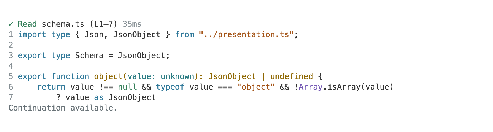 | 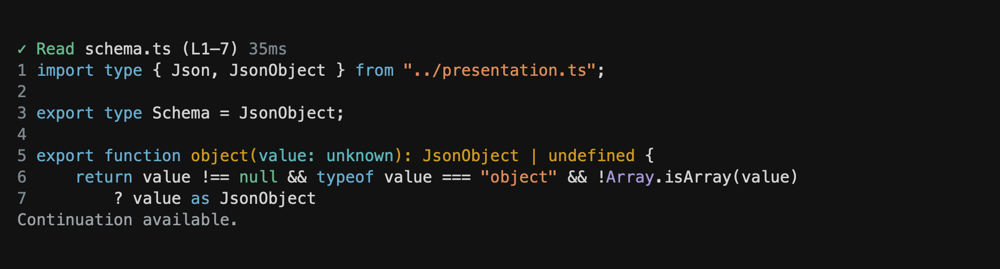 |

### Search and file listings

Pi `grep` / `find` / `ls`, FFF search tools, and Lens symbol/AST search. This FFF
example marks matching rows with `›` and keeps context and file annotations.
File discovery and directory results use path lists.

| Light | Dark |
| --- | --- |
| 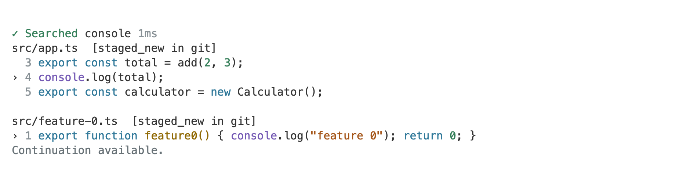 | 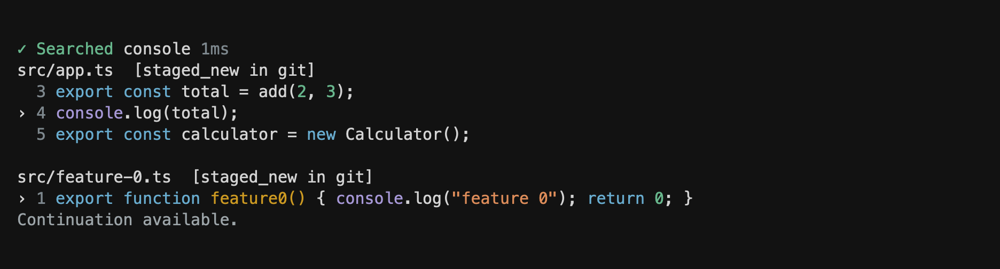 |

### File changes

Pi `write` / `edit`, `apply_patch` tools, Hashline edits and Mitsupi replacements.
The same edit is shown in Unified and Split layouts with inline change emphasis.
Patch batches can keep multiple file-operation sections together in one card.

| Layout | Light | Dark |
| --- | --- | --- |
| Unified | 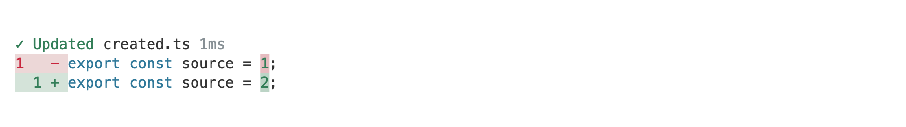 | 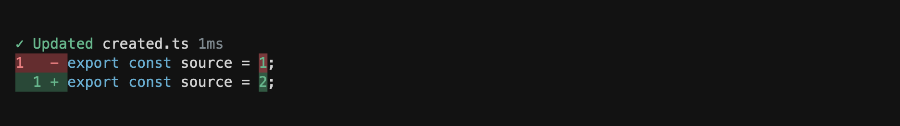 |
| Split | 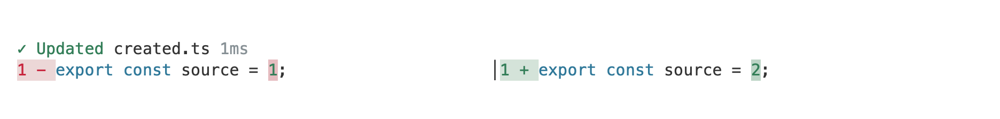 | 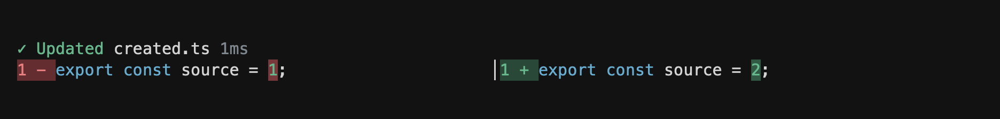 |

### Commands and sessions

Pi `bash`, `exec_command`, `shell_command` and `write_stdin`: command source,
bounded output and returned status. This example shows a completed command with
its source expanded; session launch, poll and input tools use the same family.

| Light | Dark |
| --- | --- |
| 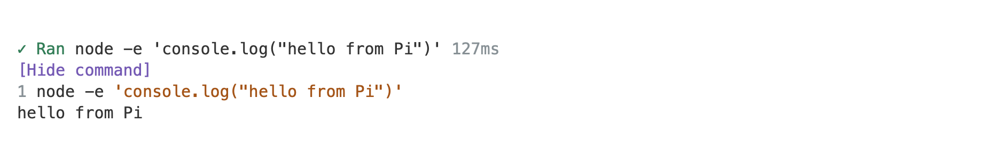 | 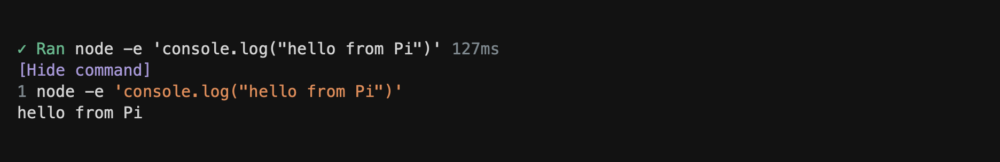 |

### Codemode and program execution

Native Codemode and `@boozedog/pi-codemode`, alongside compatible JavaScript and
TypeScript execution tools: expandable source and result previews. This Codemode
example shows the submitted program above its returned output, with the source
expanded and the result preview still bounded.

| Light | Dark |
| --- | --- |
| 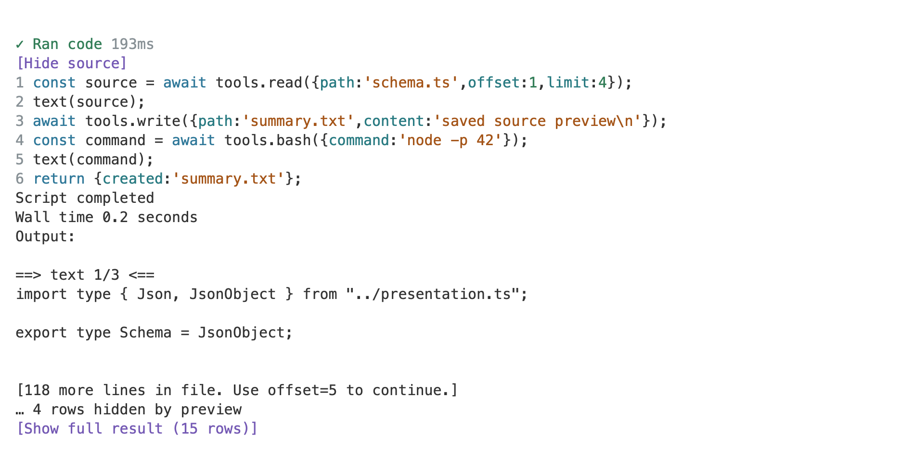 | 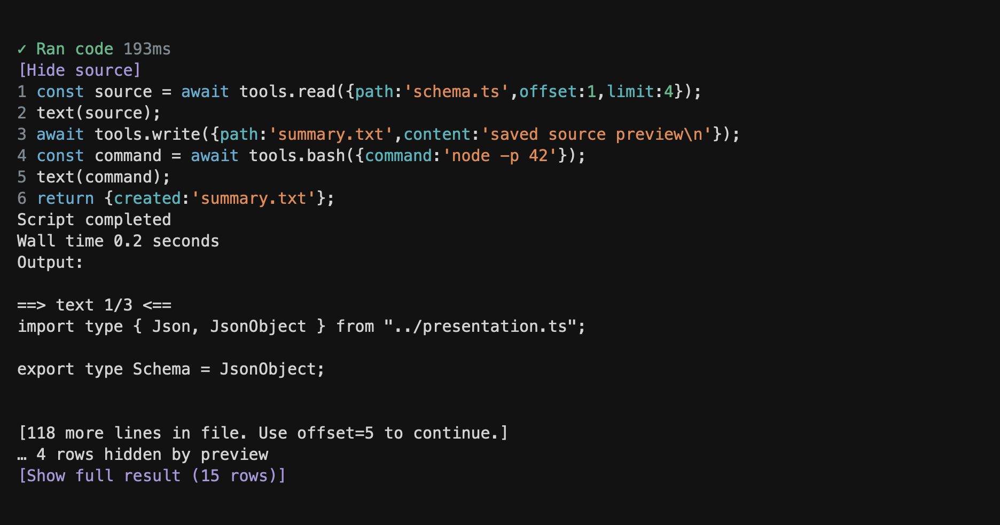 |

### Code insight

Lens outlines, source/navigation, hover, diagnostics and module/project reports.
This syntax outline groups files, nested symbols and supplied locations.

| Light | Dark |
| --- | --- |
| 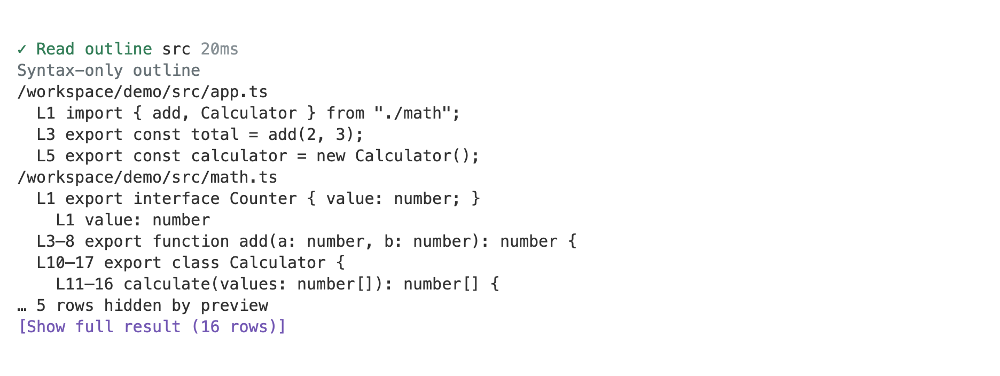 | 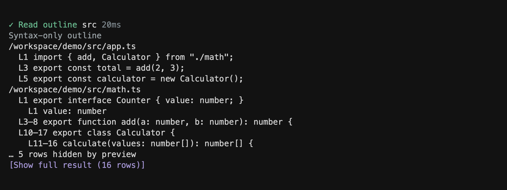 |

### Web tools

Web Access, Web Search and Codex-style web tools: queries, browsing actions,
fetches, source checks and stored-result slices. This two-target fetch retains one
returned page, one missing page and the provider's result text, including the
partial failure.

| Light | Dark |
| --- | --- |
| 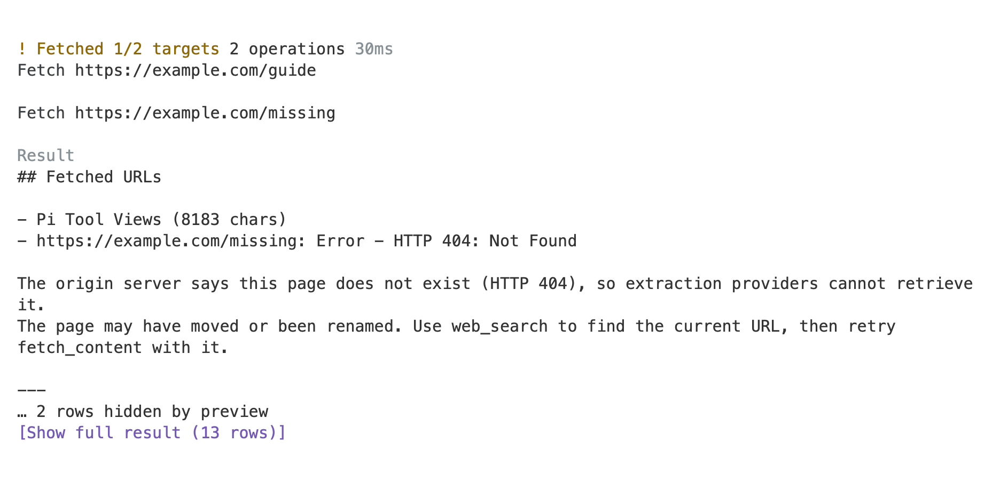 | 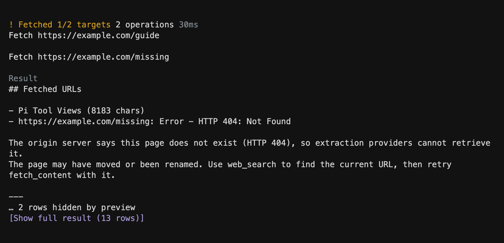 |

### Image tools

`view_image` and image-generation requests, including supplied prompts/settings.
Pi handles image pixels. This crop shows the image-view tool card and description,
not the native image itself; Tool Views does not re-encode it or make a thumbnail.

| Light | Dark |
| --- | --- |
| 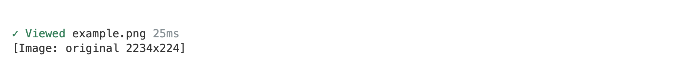 | 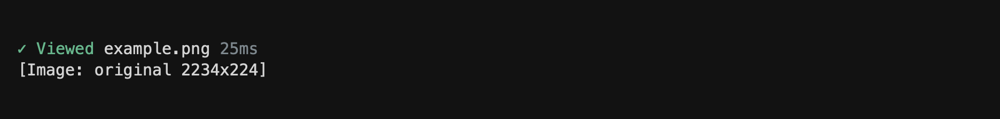 |

See [tool coverage](docs/tools.md) for full package names, example releases and the
limits of specialized views.

## Use

Once loaded, Tool Views formats tool cards automatically. Use their controls to
open the parts you want to see:

- **Show command/source** opens a shell command or JavaScript/TypeScript source.
  Both start collapsed by default.
- **Show full result** and **Collapse result** switch between a preview and all
  content returned by the tool.
- **Show full arguments** opens the complete arguments on cards with a general
  argument preview.
- **Show reported changes**, when present, opens a matching change report that was
  collapsed to avoid repeating the preview.

Type `/tool-views` followed by a space to see `inspect` and `help` suggestions.
Run `/tool-views help` for usage.

Opening the outer Pi card does not automatically open its command or source.
Expansion choices last for the current session; see
[card expansion](docs/settings.md#card-expansion) for their lifetime and defaults.

For keyboard access, run `/tool-views inspect`, select a call with ↑/↓, and press
Enter. Use ←/→ to switch between arguments, source/diff and result; ↑/↓ scrolls.
Esc returns to the list, then closes it. Inspection is read-only. Native images
stay in the transcript rather than being duplicated in this screen.

Expanding a result shows everything the tool returned, but cannot recover content
the tool itself truncated. Requests and previews are labeled separately from
reported changes; they do not establish which edits were applied. Warnings, errors
and partial-application information remain visible.

## Customize

Run `/tool-views` to choose a diff layout, adjust preview length, toggle line
numbers, or change initial source visibility. Layout changes can be previewed
before you **Save** or **Cancel**.

Defaults use Auto diffs, line numbers and a 12-row result preview. Whole-row diff
tint is off. Auto uses Split where width and a paired before/after change allow it,
otherwise Unified.

See the [settings reference](docs/settings.md) for every option, configuration
files and save behavior.

## Compatibility

- The Pi integration targets the 1.4.0 APIs.
- Not every tool result has a specialized view; other data keeps a general
  argument/result presentation.
- Pi still handles images. A bottom rule can be omitted when the host cannot
  place it after native media.
- The PiG frontend has limited support: card mouse controls and Native renderers are
  unavailable. Use `/tool-views inspect` to read full data.
